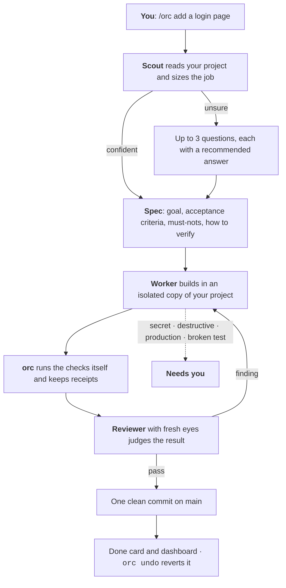

<p align="center">
  
  
  
  
  
</p>

<h1 align="center">orc</h1>

<p align="center"><strong>Describe a change. Get back a tested, reviewed, merged commit you can undo.</strong><br>
A development orchestrator for Claude Code, built for people who are not engineers yet.</p>

<p align="center">
  <a href="#quick-start">Quick start</a> ·
  <a href="#4-your-first-ticket">First ticket</a> ·
  <a href="#why-you-can-trust-what-it-merges">Why trust it</a> ·
  <a href="#everyday-commands">Commands</a> ·
  <a href="#when-it-stops-and-asks-you">When it stops</a> ·
  <a href="#what-it-costs">Cost</a> ·
  <a href="docs/GUIDE.md">Full guide</a> ·
  <a href="docs/orc-guide.pdf">PDF</a>
</p>

---

You type what you want in plain words. orc turns it into a ticket, builds it in an isolated copy of your project, runs your checks itself, has a second AI with fresh eyes review the result, and merges one clean commit. You get a card with what changed, how to try it, what it cost, and one command to undo it.

There are no approval gates. It stops for exactly three things: a **secret**, a **destructive command**, or a **production action**. Those are yours. Everything else runs while you keep talking.



## Is this for you?

**Yes** if you have a project (or want one), a Claude subscription, and you would rather describe outcomes than approve every file change. You do not need to know what a worktree or a conventional commit is. orc does the engineering discipline underneath: specs, tests, review, receipts, lessons.

**Not yet** if you want to watch and approve each step. Plain Claude Code does that well. orc is for the moment you trust the process more than your own attention span.

## What you get back

After a ticket merges, this is what you see:

```
┌ T-006 merged ────────────────────────────────────────────────────────┐
│ What changed   Added titleCase(text) in text.mjs, which uppercases…  │
│ Try it         1. npm test                                           │
│ Checks         pass · 1 receipt(s) run by orc · revert check pass    │
│ Diff           4 files changed, 43 insertions(+), 1 deletion(-)      │
│ Review         1 of 1 criteria verified · 3 finding(s), 0 blocking   │
│ Cost           $0.46 · scout haiku 3k · worker sonnet 2k · reviewer… │
│ Undo           orc undo T-006                                        │
└──────────────────────────────────────────────────────────────────────┘
```

Plus a `vault/` folder you can open in Obsidian, with every ticket, every decision you made, every report, and the lessons the project has learned, and a single-file dashboard (`orc dashboard --open`).

## Why you can trust what it merges

The design comes from a review of how Anthropic, OpenAI, Google and the coding-agent companies run agents, and from the papers measuring where they fail ([the research](docs/research/05-orchestration-practices.md)). One finding kept repeating: **nothing an agent says about its own work counts**. orc is built around that.

- **orc runs the checks, not the agent.** After the build, orc itself runs your test command and every verification step in the spec, and stores a receipt: commit, command, exit code, output. The reviewer and the done card show receipts, never the worker's claims.
- **New tests must fail without the change.** orc reverts the code, runs the tests again, and flags tests that still pass as inert.
- **Existing tests are read-only for the worker.** A hook blocks edits to tests and fixtures that existed before the ticket. If an old test is wrong, the worker reports it and stops instead of working around it.
- **Review is a fresh process with one job.** Each judge starts with no memory of the build, is told what cheating looks like (hard-coded outputs, skipped tests, edited configs), and must say *unknown* when it cannot tell. Only findings with confidence 0.7 or higher trigger a fix round.
- **Loops get stopped.** The same tool call three times in a row is a warning; six times ends the run. Each round hands a written ledger to a fresh process. orc never resumes a session into its own mistakes.
- **Secrets are never touched.** Files named `.env*`, `*key*`, `*secret*`, `*credential*` cannot be read, printed or written by any agent. When a task needs one, the ticket names the variable and where it goes, and hands that step to you.
- **Every merge is one clean commit you can undo.** Commits follow [Conventional Commits](https://www.conventionalcommits.org/en/v1.0.0/), the worker's are checked by a hook, and the merge squashes the ticket into one. `orc undo T-006` reverts it and opens a redo ticket.
- **It is one file.** The whole engine is `plugins/orc/bin/orc.mjs`, plain Node, no dependencies. You, or your Claude, can read all of it.

`orc explain proof` prints this list from the terminal; `orc explain` prints how every part works.

## Quick start

Four steps if you are starting from nothing. If you already use Claude Code from a terminal and have Node and git, jump to [step 3](#3-install-orc).

### 1. Get Claude Code

**You need a paid Claude plan**: Pro, Max, Team or Enterprise, or a Claude Console account with API credits. The free plan does not include Claude Code. Pick one at [claude.com/pricing](https://claude.com/pricing).

Open a terminal and run the line for your system. Never used a terminal? Anthropic's [terminal guide](https://code.claude.com/docs/en/terminal-guide) shows how to open one and paste a command. On Windows, a prompt that starts with `PS` is PowerShell and one that starts with `C:` is CMD; use the matching line.

| System | Run this |
|---|---|
| macOS, Linux, WSL | `curl -fsSL https://claude.ai/install.sh \| bash` |
| Windows PowerShell | `irm https://claude.ai/install.ps1 \| iex` |
| Windows CMD | `curl -fsSL https://claude.ai/install.cmd -o install.cmd && install.cmd && del install.cmd` |

The installer prints nothing while it downloads. When it finishes, **open a new terminal window** and run:

```
claude --version
```

A working install prints a version such as `2.1.317 (Claude Code)`. Then run `claude` once in any folder; it opens your browser to sign in, and remembers you from then on. Type `/exit` to leave.

<details>
<summary>If <code>claude</code> is "not found", or anything else goes wrong</summary>

The install folder is not on your PATH yet. Anthropic's [install troubleshooting page](https://code.claude.com/docs/en/troubleshoot-install) matches each error to a fix. Homebrew (`brew install --cask claude-code`) and WinGet (`winget install Anthropic.ClaudeCode`) also work, but do not update themselves. The native install updates in the background; `claude update` forces it and `claude doctor` checks it.
</details>

### 2. Get Node and git

orc's engine is a Node script and it builds and merges with git, so both must be installed. Claude Code itself needs neither, which is why you may not have them yet.

- **Node**: download the LTS version from [nodejs.org](https://nodejs.org) and run the installer with the defaults. Check with `node --version`; you want v20 or higher.
- **git**: on Windows install [Git for Windows](https://git-scm.com/downloads/win) with the defaults (it also gives Claude Code the shell it prefers). On macOS run `git --version` once and accept the prompt to install the command line tools. On Linux install the `git` package. Check with `git --version`.
- **Your project must be a git repository.** If it is not yet, open a terminal in the project folder and run `git init` once. No project yet? Make an empty folder, `git init` inside it, and let your first ticket create the rest.

### 3. Install orc

Open a terminal in your project folder, start `claude`, and type these three lines inside Claude Code:

```
/plugin marketplace add LevFurmanov/startup_starterpack
/plugin install orc@orc
/orc init
```

`orc init` finds your test command (npm test, pytest, go test, cargo test), writes `orc.yaml`, creates the `vault/` folder, adds deny rules for secret files, and appends a short block to `CLAUDE.md` so that build requests go to orc. Nothing else in your project changes. **No tests yet? Fine.** Each ticket then adds a small smoke check for the thing it built.

<details>
<summary>Installing from a local clone, or using <code>orc</code> from a terminal</summary>

To test unreleased changes, or if GitHub is not reachable from your machine, point the marketplace at a local clone instead:

```
git clone https://github.com/LevFurmanov/startup_starterpack
```

then inside Claude Code `/plugin marketplace add C:\path\to\startup_starterpack` (or the equivalent path on macOS and Linux).

Every orc command also runs from a terminal once `plugins/orc/bin` from that clone is on your PATH. Windows PowerShell, one line, then open a new terminal:

```
[Environment]::SetEnvironmentVariable("Path", $env:Path + ";C:\path\to\startup_starterpack\plugins\orc\bin", "User")
```

macOS and Linux, then open a new terminal:

```
echo 'export PATH="$HOME/startup_starterpack/plugins/orc/bin:$PATH"' >> ~/.zshrc
```

`orc doctor` then tells you whether node, git, claude and the project are all set.
</details>

### 4. Your first ticket

Inside Claude Code, in your project:

```
/orc add a greet function that returns "Hello, <name>!" and cover it with a test
```

What happens, in order:

1. orc creates ticket **T-001** and runs the scout, a cheap read-only agent that lists the files involved and sizes the job.
2. If the scout is confident, you are asked nothing. Otherwise you get **at most three questions**, phrased as outcomes, each with a recommended answer. Typing `go` accepts the recommendations.
3. Claude writes the spec: goal, acceptance criteria, what must not happen, how to verify.
4. The engine builds, checks, reviews and merges in the background while you keep talking.
5. You get the done card. Try the change. If you do not like it: `orc undo T-001`.

From a terminal, `orc run "add a greet function ..."` does the same with default answers and no questions.

## Everyday commands

Inside Claude Code you mostly type `/orc <what you want>`. These are the handful you will use from a terminal; the [full list](docs/GUIDE.md#7-commands) is in the guide.

| Command | What it does |
|---|---|
| `orc status` | what is in flight, what needs you, what merged this week |
| `orc needs-you` | the tickets waiting on you, with the reason in plain words |
| `orc resume T-001` then `orc run T-001` | continue after you handled what it needed |
| `orc undo T-001` | revert the merged commit and open a redo ticket |
| `orc dashboard --open` | the board, tickets, cost, lessons and health in your browser |
| `orc cost --week` | what the week cost, per ticket, role and model |
| `orc ticket list` | every ticket with status, size and cost |
| `orc lessons list` | the rules this project has learned |
| `orc explain <topic>` | how a part works: loop, models, security, proof, cost, files… |
| `orc doctor` | check node, git, claude, config and worktrees |

## When it stops and asks you

`needs-you` is the only state that waits for you, and `orc needs-you` always says why in plain words. The reasons:

- **A secret is needed.** The ticket names the variable and where it goes. You set it; the agent never sees the value.
- **A destructive or production command is needed.** Force pushes, hard resets, `rm -rf`, dropping tables, deploys, publishes, ssh. You run it yourself, or decide not to.
- **An existing test is wrong.** The worker will not edit it. You decide; `orc ticket allow-tests T-001 <path>` logs the exception.
- **The spec cannot be built as written**, or the worker hit its caps three times.

Handle it, then `orc resume T-001` and `orc run T-001`.

## What it costs

Every agent runs with a turn cap, a time cap and a dollar budget set by its ticket size. From the live runs on a small repository with the default models:

| Ticket | Scout | Worker | Reviewer | Total |
|---|---|---|---|---|
| greet function, one fix round | haiku, 1 cent | sonnet, 32 cents | opus, 36 cents | $0.69 |
| slugify with tests | haiku, 1 cent | sonnet, 21 cents | opus, 42 cents | $0.64 |
| titleCase with tests | haiku, 1 cent | sonnet, 13 cents | opus, 32 cents | $0.46 |

Each took about three minutes of agent time. The budgets per size are in `orc.yaml` (S $2, M $8, L $25 by default) and `orc models suggest` tells you, from your own history, whether a cheaper or dearer model would do better.

**RAM.** Each agent is its own Claude process, roughly 0.3 to 1 GB plus your test command. orc counts how many can run at once from your machine (RAM after a 4 GB reserve, cores, a ceiling of six) and never starts more, in the engine or from your session. `orc doctor` prints the number and the arithmetic; every run records each agent's real peak so the estimate adjusts to your project. Set `caps.agents` in `orc.yaml` to pin it lower, down to one at a time.

## Where things live

```
orc.yaml                   configuration, edit freely, every line has a comment
vault/                     the words, Obsidian-friendly
  Board.md · Home.md       kanban and overview as text
  Dashboard.html           single-file dashboard
  Decisions.md             every answer you gave, across tickets
  Tickets/T-001-*.md       the spec you and Claude edit
  Reports/T-001/           scout, checks, review and work reports
  Lessons/L-001-*.md       rules the project has learned
.orc/tickets/              the records: status, cost, receipts, events (JSON, committed)
.claude/rules/             short rules Claude loads only when editing matching files
CLAUDE.md                  a short block that routes build requests to /orc
```

State is JSON, words are markdown. Postgres is optional, for several people on one project, and documented in the guide.

<details>
<summary><strong>Under the hood</strong>: who runs what, and how size decides the ceremony</summary>

<br>

The conversation runs in your Claude Code session: ticket, scout, questions, spec. Everything after that is code: `orc run T-001` launches each agent as its own headless Claude process with the model, caps, tool list and security guard set by orc. Agents do the work; orc owns state, git, checks, review routing and merge.

| Step | Who | Model | Produces |
|---|---|---|---|
| scout | engine | haiku | files involved, size, confidence |
| spec | your session | your session | a spec under 60 lines |
| build | engine | sonnet, opus for L | commits on branch `orc/T-001` in a worktree |
| check | engine | none | receipts, revert check |
| review | engine | worker's model at high effort, opus for L | findings with confidence |
| fix | engine | same as build | at most 2 rounds |
| merge | engine | none | one squashed Conventional Commits commit on main |
| learn | engine | none | validated lessons |

| Size | Means | Worker | Review |
|---|---|---|---|
| S | one file, text or config, no new behavior | sonnet | checks only |
| M | up to five files, one behavior | sonnet | bug judge |
| L | anything else, or auth, payments, deletion, migrations, secrets | opus | bug, proof and simplify judges |
| chore | renames, formatting, dependencies | haiku | checks only |

Anything the scout estimates above two hours is split into dependent tickets you build one after another. Lessons are one-sentence rules that orc validates, files as hypotheses, and promotes only after they are confirmed a second time; they expire from prompts after sixty days unused.
</details>

## Status and known limits

Pre-release. The engine has run end to end on Windows 11 with Node 24 and Claude Code 2.1; the numbers above are from those runs.

- One ticket builds at a time. Parallel tickets are designed, not built.
- macOS and Linux should work (plain Node and git) but have not been run end to end.
- No notifications and no post-merge CI watch yet; `orc status` and the dashboard are the signal.
- Postgres applies the schema only; mirroring into it is not finished.
- The in-session `/orc` conversation is the part under test right now. Expect rough edges and say so.

## Documentation

- [User guide](docs/GUIDE.md), also as a [PDF](docs/orc-guide.pdf): install, first ticket, every command, `orc.yaml`, costs, limits.
- [System design](docs/SYSTEM-DESIGN.md): the terminal walkthrough `orc explain` prints.
- [Design notes](docs/DESIGN.md): the decisions and why.
- [Research](docs/research/05-orchestration-practices.md): how labs and companies orchestrate coding agents, and what orc adopted and rejected.

## Feedback

Something stopped, cost too much, or merged something it should not have? Open an issue with the ticket id and the output of `orc ticket log T-###`. The records in `.orc/tickets` and the reports in `vault/Reports` hold everything needed to see what happened.
